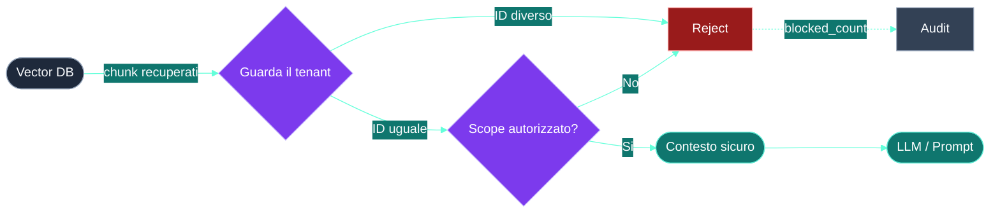
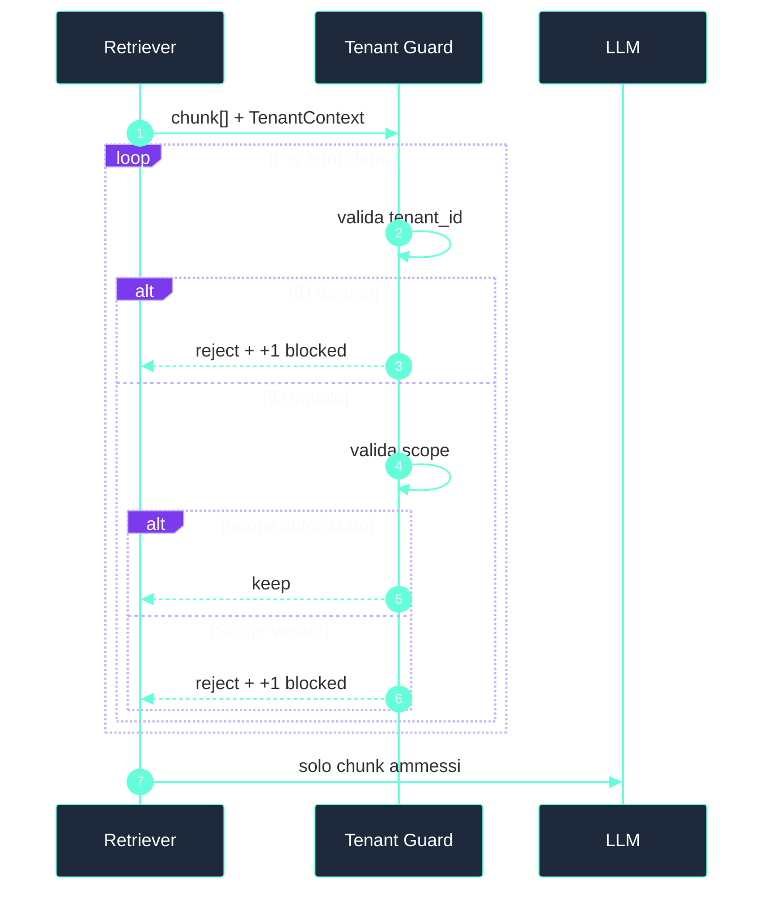

# rag-tenant-guard

<div align="center">

**Il fail-closed gate per RAG multi-tenant.**

Isola i tenant, valida gli scope e impedisce che dati del posto sbagliato
raggiungano il prompt dell'LLM.

[](https://www.python.org/)
[](pyproject.toml)
[](pyproject.toml)
[](LICENSE)

<picture>
  <source media="(prefers-color-scheme: dark)" srcset="https://readme-typing-svg.demolab.com?font=Fira+Code&weight=700&size=22&duration=3000&pause=700&color=64FFDA&center=true&vCenter=true&width=760&lines=Tenant+A...+Tenant+B...+Zero+leakage.;Scope+validato+prima+del+prompt.;RAG+multi-tenant%2C+per+d+e+s+i+g+n.">
  
</picture>

</div>

---

## Perché esiste

Nei sistemi RAG multi-tenant, un filtro non correttamente applicato può combinare
chunk privati di tenant diversi nello stesso contesto.

`rag-tenant-guard` mette una barriera deterministica tra retriever e LLM:



<div align="center">

`NON PASSA` &#8594; Tenant mismatch &nbsp;&nbsp;|&nbsp;&nbsp; `NON PASSA` &#8594; Scope mancante o non autorizzato

</div>

---

## Cosa garantisce

| Protezione | Comportamento |
|---|---|
| Isolamento tenant | Il `chunk.tenant_id` deve essere identico al `TenantContext.tenant_id` |
| Identità valida | Tenant vuoti o circondati da spazi vengono rifiutati |
| Isolamento scope | Quando `allowed_scopes` è configurato, il metadata `scope` deve essere presente e autorizzato |
| Modalità filter | Restituisce i chunk ammessi e conta quelli bloccati |
| Modalità strict | Interrompe al primo chunk che viola tenant o scope |
| Modelli protetti | I dataclass usano `frozen=True` e `slots=True` |
| Zero dipendenze | Nessuna libreria runtime esterna |

---

## Quickstart

### Installazione

```bash
git clone https://github.com/andrea-fiorletta/rag-tenant-guard.git
cd rag-tenant-guard

python -m venv .venv
.venv\Scripts\activate
python -m pip install -e .
```

Su macOS o Linux:

```bash
source .venv/bin/activate
```

### Filter mode

```python
from rag_tenant_guard.isolation import enforce_tenant_isolation
from rag_tenant_guard.models import DocumentChunk, TenantContext

context = TenantContext(
    tenant_id="tenant-acme",
    allowed_scopes=frozenset({"public", "internal"}),
)

chunks = (
    DocumentChunk(
        chunk_id="chunk-01",
        tenant_id="tenant-acme",
        content="Il rollout è previsto per lunedì.",
        metadata={"scope": "internal"},
        score=0.94,
    ),
    DocumentChunk(
        chunk_id="chunk-02",
        tenant_id="tenant-other",
        content="Dati riservati di un altro tenant.",
        metadata={"scope": "internal"},
        score=0.91,
    ),
)

allowed, blocked_count = enforce_tenant_isolation(context, chunks)

assert len(allowed) == 1
assert blocked_count == 1
```

### Strict mode

```python
from rag_tenant_guard.isolation import enforce_tenant_isolation
from rag_tenant_guard.models import (
    DocumentChunk,
    TenantContext,
    TenantIsolationError,
)

context = TenantContext(
    tenant_id="tenant-acme",
    allowed_scopes=frozenset({"public"}),
)

try:
    enforce_tenant_isolation(
        context,
        (
            DocumentChunk(
                chunk_id="chunk-02",
                tenant_id="tenant-other",
                content="Non dovrebbe superare il gate.",
                metadata={"scope": "public"},
            ),
        ),
        strict=True,
    )
except TenantIsolationError as error:
    print(error)
```

Il messaggio usa l'ID del chunk e la motivazione del rifiuto, senza esporre il
contenuto del documento.

---

## Esempio di decisione



### Modalità disponibili

```python
# Filter mode: continua e restituisce il conteggio dei blocchi
allowed, blocked_count = enforce_tenant_isolation(context, chunks)

# Strict mode: solleva TenantIsolationError al primo chunk non valido
allowed, blocked_count = enforce_tenant_isolation(
    context,
    chunks,
    strict=True,
)
```

> Quando `allowed_scopes` è una frozenset vuota, il controllo scope viene ignorato.
> Per un RAG multi-tenant, configura sempre gli scope autorizzati.

---

## Modelli principali

```text
TenantContext
├── tenant_id: str
└── allowed_scopes: frozenset[str]

DocumentChunk
├── chunk_id: str
├── tenant_id: str
├── content: str
├── metadata: dict[str, str]
└── score: float

GuardResult
├── tenant_id: str
├── allowed_chunks: tuple[DocumentChunk, ...]
├── blocked_count: int
└── redactions_count: int
```

Eccezioni disponibili:

- `GuardError`
- `InvalidTenantError`
- `TenantIsolationError`

Modello dati PII:

- `RedactionMatch`

`RedactionMatch` è il modello dati relativo alle occorrenze PII, ma il motore di
redazione e l'orchestratore completo non sono ancora implementati.

---

## Struttura del progetto

```text
rag-tenant-guard/
├── src/
│   └── rag_tenant_guard/
│       ├── __init__.py
│       ├── isolation.py
│       └── models.py
├── tests/
│   ├── __init__.py
│   └── test_isolation.py
├── pyproject.toml
├── LICENSE
└── README.md
```

---

## Qualita e sviluppo

Il progetto usa Python 3.12, Ruff, Mypy strict e pytest.

```bash
ruff format --check src tests
ruff check src tests
mypy src
pytest
```

Il pacchetto non ha dipendenze runtime:

```toml
dependencies = []
requires-python = ">=3.12"
```

---

## Roadmap

- [x] Dataclass immutabili e gerarchia delle eccezioni
- [x] Validazione tenant e scope
- [x] Modalita filter e strict
- [ ] Motore deterministico PII
- [ ] Redazione dei chunk prima del prompt
- [ ] Risultato end-to-end tramite `GuardResult`
- [ ] CLI per ispezione locale
- [ ] CI su GitHub Actions

---

## Licenza

Distribuito con licenza [MIT](LICENSE).

<div align="center">

**Dati degli altri tenant = mai nel tuo prompt.**

</div>
